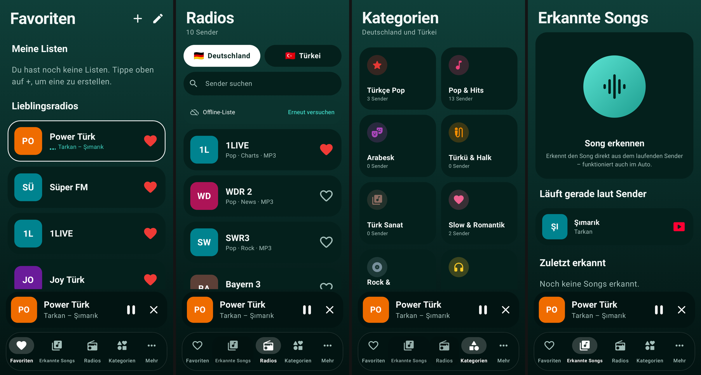

# Radio DE·TR



Radio-App für Android (ab Android 8, abgestimmt auf Samsung One UI 9 / Android 17) mit deutschen und türkischen Sendern.

**Download:** `radio.apk` im Hauptordner des Repos.

## Funktionen

Dunkles Design mit Petrol-Verlauf, großen Überschriften, einzelnen Senderkarten mit Herz und schwebender
Navigationsleiste: **Favoriten · Erkannte Songs · Radios · Kategorien · Mehr**.

- **Favoriten:** „Lieblingsradios“ (Herz antippen) und **Meine Listen** (oben auf +). Lange auf einen Sender drücken →
  „Zu Liste hinzufügen“. Der Stift schaltet in den Bearbeiten-Modus (Reihenfolge ändern, entfernen, Listen umbenennen
  und löschen). Der laufende Sender hat einen weißen Rahmen.
- **Radios:** zwei Länderlisten, Deutschland 🇩🇪 und Türkei 🇹🇷, jeweils die beliebtesten Sender aus dem freien
  Verzeichnis radio-browser.info, mit Suche. Gespeichert auf dem Gerät, nach unten ziehen aktualisiert.
- **Kategorien:** Türkçe Pop, Pop & Hits, Arabesk, Türkü & Halk, Türk Sanat, Slow, Rock, Hip-Hop, Dance, Schlager,
  Oldies, Nachrichten, Jazz/Klassik – jeweils Sender aus beiden Ländern.
- **Erkannte Songs (Musikerkennung):** Läuft ein Sender, wird der Song direkt aus dessen Ton erkannt (kein Mikrofon
  nötig, klappt auch im Auto), sonst über das Mikrofon. Erkennung über AudD (audd.io). Der Treffer öffnet sofort das
  passende **YouTube-Video** (abschaltbar unter „Mehr“). Dazu der Song laut Sender und der Verlauf.
- **Mini-Player:** Play/Pause und ✕ (beenden); antippen öffnet den großen Player mit Weiter/Zurück, Herz, YouTube.
- **Auto / Bluetooth:** MediaSession (media3). Play/Pause, Weiter/Zurück (= nächster Sender der gewählten Liste),
  Sender- und Songname im Autodisplay, „Play“ im Auto setzt mit dem letzten Sender fort. **Android Auto:** Favoriten,
  Meine Listen, Deutschland, Türkei, Kategorien, Suche, Herz-Knopf.
- Ab Android 8, abgestimmt auf One UI 9 / Android 17 (randlos, Vorhersage-Zurückgeste), Deutsch und Türkisch.

## Bauen

```
cd radio
RADIO_KEY_PASS=<privates Passwort> ./build-release.sh     # erzeugt ../radio.apk
```

Der Signatur-Schlüssel liegt nur verschlüsselt im Repo (`app/radio-release.jks.enc`). Ohne das Passwort lässt sich
keine Update-fähige APK bauen.

`./gradlew :app:testDebugUnitTest` erzeugt Bildschirmfotos aller Bereiche (Robolectric) in `app/build/screens`. Gebaut wird mit Android-SDK 37, AGP 9.5, Kotlin 2.4, Jetpack Compose und media3.

## Daten

Favoriten, Verlauf und Einstellungen bleiben auf dem Gerät. Nur für eine angestoßene Erkennung wird ein kurzer
Tonausschnitt an AudD geschickt; für das YouTube-Video wird die YouTube-Suche mit Interpret und Titel aufgerufen.
